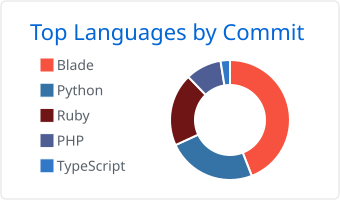
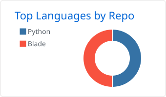

# Ciao, sono Adriano 👋

### 🚀 Chi sono

- 👨‍💻 **Studente Magistrale in Ingegneria Informatica e dell'Automazione**
- 🎓 **Formazione:** Laurea in Informatica (L-31) e attualmente in corso alla magistrale di Ingegneria Informatica e dell'Automazione (LM-32)
- 💬 **Parliamo di:** Web Development, Applicativi di Rete, Databases

---

### 📊 Linguaggi e Strumenti Principali

### 📊 Linguaggi più usati

  
  

